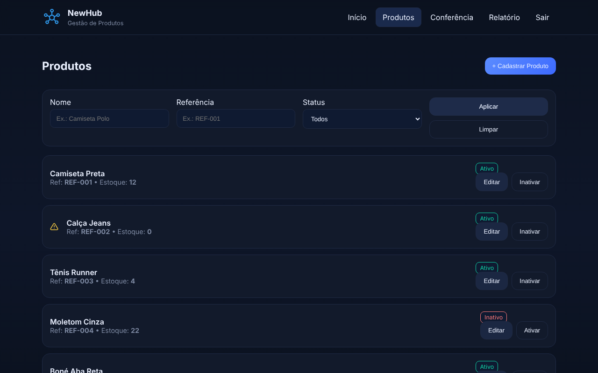
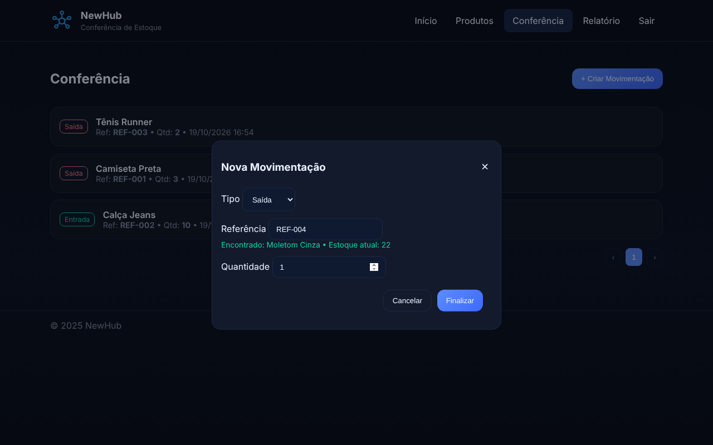
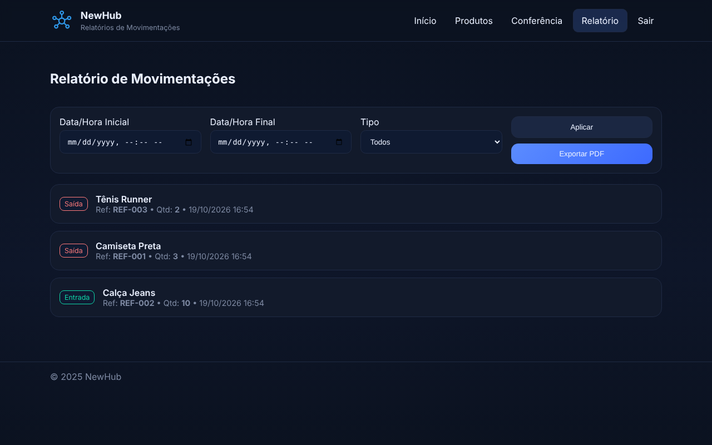

<p align="center">
  
</p>

# NewHub — Gestão de Produtos e Estoque

Sistema web de **controle de estoque** feito com **HTML, CSS e JavaScript puro**: cadastro de produtos, entradas e saídas de estoque, relatório por período com **exportação em PDF** e login de acesso.

🔗 **[Ver o sistema no ar](https://oliversoriano.github.io/new-hub/)** · acesso de demonstração: **admin** / **1234**



## ✨ Funcionalidades

**Produtos**
- Cadastro e edição de produtos (nome, referência, estoque e status)
- Ativar/inativar produtos
- Filtros por nome, referência e status, com paginação
- Alerta visual ⚠️ para produtos com estoque zerado
- Bloqueio de referência duplicada

**Conferência (movimentações)**
- Registro de **entrada** e **saída** de estoque
- Busca automática do produto ao digitar a referência, mostrando o estoque atual
- Impede saída maior que o estoque disponível
- O estoque do produto é atualizado a cada movimentação

**Relatório**
- Filtro por intervalo de data/hora e por tipo (entrada/saída)
- **Exportação para PDF** com tabela ([jsPDF](https://github.com/parallax/jsPDF) + AutoTable)

**Acesso**
- Tela de login com API simulada (assíncrona, com `Promise`)
- Páginas internas protegidas: sem login, o usuário é redirecionado

| Conferência | Relatório |
|---|---|
|  |  |

## 🛠️ Tecnologias


- JavaScript puro (sem frameworks), organizado por página
- **localStorage** para guardar produtos, movimentações e sessão
- jsPDF + jspdf-autotable para gerar o PDF
- Textos digitados pelo usuário são escapados antes de ir para o HTML (proteção contra XSS)

> ℹ️ Este é um projeto **front-end**: os dados ficam salvos no navegador e o login é simulado. Na primeira visita, alguns produtos de exemplo são carregados para facilitar o teste.

## 🚀 Como rodar

Não precisa instalar nada. Clone o repositório e abra o `index.html` no navegador:

```bash
git clone https://github.com/oliversoriano/new-hub.git
```

## 📁 Estrutura

```
new-hub/
├── index.html         # Página inicial
├── login.html         # Login
├── produtos.html      # Cadastro e lista de produtos
├── conferencia.html   # Entradas e saídas de estoque
├── relatorio.html     # Relatório + exportação em PDF
├── script.js          # Lógica de todas as páginas
├── style.css          # Estilos
├── img/               # Logo
└── docs/              # Imagens do README
```

## 🗺️ Próximos passos

- [ ] Back-end com banco de dados (Node.js + SQLite) e autenticação real
- [ ] Exportar o relatório também em Excel/CSV
- [ ] Dashboard com gráfico de entradas x saídas

## 👤 Autor

**[Oliver Soriano](https://github.com/oliversoriano)**
